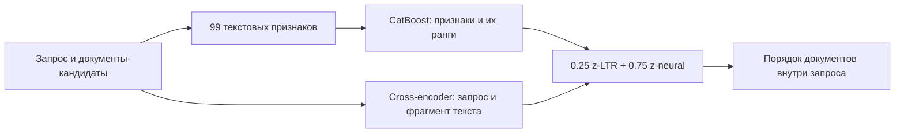

# Финальный проект: ранжирование документов VK MARCO

Игорь Бердов. Kaggle: **whuliss**.

[Условия проекта](https://github.com/RuslanAllayarov/ir-course-hse-2026/tree/main/project),
[приглашение в соревнование](https://www.kaggle.com/t/cc1cd78712d742e6873be32536efa54e).
Дедлайн сабмишна и ссылки на репозиторий — **6 декабря 2026, 23:59 МСК**.
Защита — **9 декабря**, рассказ на **5–7 минут** и ответы на вопросы.

Система переранжирует **готовые списки документов-кандидатов** из соревнования.
Извлечение кандидатов для произвольного нового запроса здесь не реализовано.
Для каждой строки `objects.csv` возвращается числовой `Score`: больше — выше в выдаче.

## Текущий результат

<!-- RESULTS_START -->
**Выбрана смесь CatBoost YetiRank и открытого cross-encoder.** Настройки выбраны
на tune и зафиксированы до итоговой проверки на 2 000 holdout-запросов.

| Вариант | Tune nDCG@10 | Holdout nDCG@10 |
| --- | ---: | ---: |
| BM25F | 0.595958 | 0.595579 |
| CatBoost + ранги признаков | 0.614246 | 0.610591 |
| 0.25 CatBoost + 0.75 cross-encoder | 0.643133 | **0.641919** |

На holdout прирост к BM25F — **+0.046340**;
95% парный bootstrap-интервал **[0.040256; 0.052206]**.
К CatBoost — **+0.031327**, интервал **[0.026052; 0.036968]**.
Это локальная оценка, её нельзя напрямую сравнивать с публичным бейзлайном
Kaggle **0.592** на других запросах.

Финальный CPU-запуск создал **63 546 строк для 2 000 запросов**. Проверены
ObjectId, порядок, полнота и конечность скоров; повторный запуск с кэшами без
сети дал побайтно одинаковый CSV. [Проверка файла](reports/official/submission-validation.json),
[проверка повторного запуска](reports/official/reproduction-check.json).

Публичный скор проекта на Kaggle пока не получен; подтверждения отправки
сабмишна и ссылки в LMS пока нет. Скор будет добавлен после обработки CSV
в Kaggle.
<!-- RESULTS_END -->

## Время и память

Замеры на **Apple M1 Pro, 16 ГБ RAM, Python 3.12.3**, 4 CPU-потока:

| Этап | Время | Пик RSS процесса |
| --- | ---: | ---: |
| Полный корпус → признаки и SQLite, без готового кэша | 22,06 мин | 1,21 ГиБ |
| Финальный `solution.py`: готовые признаки, обучение всех train и нейросеть на CPU | 29,46 мин | 1,54 ГиБ |
| Повторный запуск без сети с готовыми моделями и кэшами | 4,95 с | отдельно не замерялся |

[Замер признаков](reports/features/runtime.json),
[замер финального CPU-запуска](reports/official/final-runtime.json).
**GPU не требуется.** Ориентир первого запуска на этой машине — около
**52 минут без скачивания файлов**: это сумма двух отдельно измеренных этапов,
а не замер единой холодной команды. Во время CPU-запуска параллельно шла
проверка Linux; скорость зависит от нагрузки и оборудования. RSS не включает
все файловые буферы ОС; для работы с запасом разумно выделить 8 ГБ RAM.
На диске нужно около 35 ГБ вместе с исходным архивом и окружением.

## Окружение и данные

Python **3.12**, Linux или macOS. Из корня репозитория:

```sh
cd project
python3.12 -m venv .venv
source .venv/bin/activate
```

На Debian/Ubuntu нужна системная библиотека OpenMP для LightGBM:

```sh
sudo apt-get update
sudo apt-get install -y libgomp1
```

На Linux для работы без GPU сначала установите CPU-сборку PyTorch, чтобы
не скачивать библиотеки CUDA:

```sh
python -m pip install torch==2.15.0 --index-url https://download.pytorch.org/whl/cpu
```

Затем на Linux или macOS:

```sh
python -m pip install -r requirements.txt
chmod +x solution.py
```

`requirements.txt` содержит зафиксированные зависимости отдельного окружения
проекта. GPU не обязательна: основной запуск по умолчанию использует **CPU**.
Для нейросетевого этапа дополнительно поддерживаются CUDA и Apple MPS;
деревья обучаются на CPU.

На вкладке Data соревнования скачайте и распакуйте шесть файлов в одну папку:

```text
PATH-TO-DATA/
  vkmarco-docs.tsv
  vkmarco-doctrain-queries.tsv
  vkmarco-doctrain-qrels.tsv
  vkmarco-doceval-queries.tsv
  objects.csv
  sample_submission.csv
```

В данных **14 543 обучающих запроса и 460 030 размеченных пар**,
**2 000 тестовых запросов и 63 546 пар**. Корпус `vkmarco-docs.tsv` занимает
**16 758 392 268 байт** — около **16,76 ГБ**. Помимо распакованного корпуса,
на диске требуется место под архив, SQLite с текстами документов-кандидатов,
числовые признаки, веса нейросети и обученные модели. Все эти большие файлы
хранятся локально. SQLite занимает 7,27 ГБ, числовой кэш — 85 МБ,
нейросетевые веса — 471 МБ без токенизатора. Для корпуса, кэшей, окружения
и скачанного архива стоит выделить около 35 ГБ свободного места.

Используется только разметка из выданных файлов проекта. Полные внешние qrels
VK MARCO, платные API и закрытые модели не используются. Случайные оценки из
`sample_submission.csv` не являются обучающими метками.

## Воспроизведение сабмишна

Рядом со скриптами зафиксированы `best_config.json` и `fusion_config.json`.
`portability_manifest.json` связывает их с исходными данными и реализацией.
Требуемая условиями команда:

```sh
./solution.py --submission_file=submission.csv PATH-TO-DATA
```

Первый запуск читает корпус, строит признаки, обучает выбранную модель на всех
обучающих запросах и записывает `ObjectId,Score` в порядке строк `objects.csv`.
Если выбран нейросетевой этап, недостающие открытые веса скачиваются один раз,
затем все вычисления происходят локально. Признаки, тексты и промежуточные
нейросетевые оценки кэшируются; повторный запуск использует подходящий кэш.

Основные параметры:

| Параметр | Назначение / значение по умолчанию |
| --- | --- |
| `--cache_dir cache` | Признаки, SQLite и промежуточные нейросетевые оценки |
| `--model_dir models/final` | Обученная модель ранжирования и её метаданные |
| `--neural_model_dir cache/neural-model` | Локальные открытые веса и токенизатор |
| `--selection_file best_config.json` | Зафиксированный выбор модели ранжирования |
| `--fusion_file fusion_config.json` | Зафиксированная комбинация с нейросетью |
| `--portability_file portability_manifest.json` | Проверка происхождения данных и неизменности конфигурации |
| `--report_file reports/reproduction.json` | Отчёт запуска, число строк и SHA-256 CSV |
| `--threads 4` | Число CPU-потоков |
| `--device cpu` | Нейросеть: `cpu`, `mps`, `cuda` или `auto` |
| `--batch_size N` | Размер нейросетевого батча; без флага 16 на CPU, 32 на GPU |
| `--offline` | Запрет загрузки отсутствующих весов; полный комплект должен лежать локально |
| `--lexical_only` | Отдельная абляция без нейросетевого этапа |

Пути по умолчанию отсчитываются от папки `project`. Например, запуск с MPS:

```sh
./solution.py --submission_file=submission.csv --device=mps PATH-TO-DATA
```

Смена устройства или размера батча создаёт отдельный нейросетевой кэш.
В пилоте на 32 парах CPU и MPS дали максимальное различие скоров
`5.72e-6` и одинаковый порядок внутри трёх проверенных групп. Это не проверка
полного равенства на тесте; итоговый режим для воспроизведения — CPU.
[Результат пилота](reports/neural-pilot/cpu-mps-smoke.json).
Параметр `--lexical_only` создаёт результат абляции, который отличается
от выбранной для Kaggle комбинации.

Полный проход корпуса в Linux обнаружил различия округления `float32 log1p`
в трёх признаках LM: максимум `9.54e-7`. Поэтому переносимость проверяется
по хешам исходных файлов и кода, схеме, идентификаторам, меткам и разбиению.
Только технические хеши fit/tune в рабочей копии конфигурации адаптируются
к платформе; параметры и исходные JSON-конфигурации не меняются.
Это проверка происхождения вычислений, а не допуск для произвольного изменения
значений кэша. Ключ сохранённой модели по-прежнему содержит точный хеш её X.

Независимое обучение того же CatBoost в Linux сохранило порядок на всех
2 000 тестовых запросах. При одинаковых нейросетевых оценках итоговый CSV
совпал побайтно. Реальный Linux CPU-инференс нейросети проверен на 96 парах
из трёх полных запросов: итоговый порядок совпал; полный нейросетевой проход
теста в Linux не выполнялся. [Сравнение моделей](reports/linux-refit-comparison.json),
[сравнение итогового CSV](reports/linux-fusion-comparison.json),
[нейросетевая проверка](reports/linux-neural-smoke.json).

## Метод



**Лексические признаки.** `features.py` строит **99 признаков** по заголовку,
телу документа и URL: BM25, 13 вариантов BM25F, языковые модели Дирихле,
частоты и покрытия слов запроса, покрытия с весами IDF, точные фразы, биграммы,
минимальные окна слов, позиции совпадений, длины полей и признаки URL.
Формулы BM25/BM25F реализованы в коде проекта.

В BM25F частоты полей сначала нормируются по длине, складываются с весами,
после чего применяется общее насыщение. У `bm25f_default`: `k1=2`,
`b_body=0.6`, `b_title=b_url=0.3`, веса Title/Body/URL — `4/1/0.25`.
Лучший вариант лексического бейзлайна выбирается только на tune-запросах.

Нормализация: нижний регистр, `ё → е`, удаление комбинируемых ударений,
токены от двух символов, русский **Snowball через PyStemmer**.
Это стемминг, а не лемматизация из ДЗ2. Часть признаков дополнительно использует
точные слова без стемминга. DF, частоты слов и средние длины вычисляются
по **всему выданному корпусу без обращения к меткам релевантности**.
Корпус обрабатывается потоком; полная матрица «все документы × все слова»
не создаётся. Тексты нужных кандидатов сохраняются в `cache/documents.sqlite`.

**Обучение ранжированию.** Сравниваются LightGBM LambdaMART и CatBoost YetiRank,
исходные признаки и дополнение процентильными рангами внутри запроса.
Для выбранных моделей также проверяются небольшие ансамбли с нормировкой
скоров внутри запроса. `QueryId`, `DocumentId` и `ObjectId` не передаются
в модель как признаки. Готовая модель из ДЗ3 не переносится на новую схему:
обучение выполняется на признаках и метках этого проекта.

Выбран **CatBoost YetiRank**, 641 итерация, `depth=6`,
`learning_rate=0.04`, `l2_leaf_reg=5`, `random_seed=42`, 4 CPU-потока.
Вход — 99 исходных признаков и их 99 рангов внутри запроса.
Число итераций выбрано с early stopping на tune; при финальном обучении
на всех запросах оно фиксировано. Сравнивались также LightGBM, варианты
без рангов и смеси двух моделей; таблица сохранена в
[`reports/official/tuning-table.md`](reports/official/tuning-table.md).

**Нейросеть.** Используется открытый
[`cross-encoder/mmarco-mMiniLMv2-L12-H384-v1`](https://huggingface.co/cross-encoder/mmarco-mMiniLMv2-L12-H384-v1),
лицензия **Apache-2.0**, revision
`1427fd652930e4ba29e8149678df786c240d8825`.
Автор модели указывает обучение на многоязычных переводах **MS MARCO**.
Это готовые разрешённые открытые веса; внешняя разметка **VK MARCO**
в проект не добавляется. Модель здесь не дообучается.

Вход модели — запрос, заголовок до 40 слов и одно окно тела до 110 слов.
Окно выбирается по покрытию стемов запроса на сетке с шагом 55 слов,
без меток релевантности; длина входа ограничена 256 токенами.
Используются safetensors, локальная загрузка без `trust_remote_code`
и проверка SHA-256 весов. Нейросетевые оценки сохраняются с маской готовых
строк: отсутствующее предсказание никогда не подменяется нулём.

**Проверяемая идея проекта — условное нейросетевое переранжирование.**
На tune сравниваются обработка всех запросов и обработка только части запросов,
выбранных по нормированной энтропии `softmax(zscore(lexical_scores))`.
Также подбираются глубина списка 10/20/все кандидаты и вес нейросетевого скора.
Документы вне выбранного префикса сохраняют порядок и не поднимаются над ним.
Энтропия здесь — эвристика формы распределения, **не калиброванная вероятность
ошибки**. По качеству на tune победила обработка всех кандидатов всех запросов:
вес нейросети 0.75, вес CatBoost 0.25 после нормировки внутри запроса.
Экономные варианты оставлены в анализе компромисса качества и числа вычислений;
финальному решению экономия нейросетевых пар не приписывается.

## Валидация и повторение экспериментов

Seed **42**. Разбиение производится целыми запросами:
**10 543 fit / 2 000 tune / 2 000 holdout**. Список запросов и его хеш
сохраняются в `splits.json`; строки одного запроса не попадают в разные части.
Нормировки признаков и скоров вычисляются внутри полного списка кандидатов
каждого запроса одинаково при обучении и применении.

Метрика — средняя по запросам **nDCG@10**, gain `2^Label − 1`, discount
`1/log2(rank+1)`. При нулевом идеальном DCG запрос получает 0.
На обучающих qrels равные скоры упорядочиваются лексикографически по DocumentId;
ObjectId в обучающей разметке нет.

Параметры деревьев, число итераций, ансамбль и нейросетевая комбинация выбираются
только по tune. Перед аудитом сохраняются выбранные конфигурации и хеши входов.
Для holdout деревья переобучаются на fit+tune с уже фиксированным числом итераций.
Holdout служит финальной оценкой и парным bootstrap по запросам, не очередным
набором для подбора. Затем выбранная модель переобучается на всех 14 543 запросах.
Публичный лидерборд не является входом процедуры выбора.

Полный цикл, включая получение финальных JSON-конфигураций:

```sh
python features.py --data_dir PATH-TO-DATA --cache_dir cache

python experiments.py tune --features cache/features.npz \
  --output_dir reports/official --threads 4 --seed 42

python -c "from pathlib import Path; from neural import download_model; download_model(Path('cache/neural-model'))"

python pipeline.py neural-tune --data_dir PATH-TO-DATA --cache_dir cache \
  --output_dir reports/official --model_dir cache/neural-model \
  --config_dir . --device cpu --batch_size 16 --threads 4

python portability.py --features cache/features.npz \
  --selection_file best_config.json --output_file portability_manifest.json \
  --data_dir PATH-TO-DATA

python pipeline.py audit --data_dir PATH-TO-DATA --cache_dir cache \
  --output_dir reports/official --model_dir cache/neural-model \
  --config_dir . --device cpu --batch_size 16 --threads 4

./solution.py --submission_file=submission.csv PATH-TO-DATA
```

Для MPS/CUDA в двух командах `pipeline.py` можно явно заменить `--device`
и `--batch_size`. Для повторения именно зафиксированной итоговой конфигурации
достаточно `solution.py`; весь поиск параметров повторять не требуется.
`pipeline.py` возобновляет подходящие нейросетевые кэши, но не разрешает
заново подбирать комбинацию после начала holdout-аудита.

Подробные результаты сохраняются в `reports/official/`: сравнение вариантов,
выбор модели и комбинации, финальный holdout и предсказания для проверки.

- [Отчёт с таблицами, графиками и выводами](REPORT.md).
- [Слайды защиты с заметками докладчика](slides/final-project.pptx).
- [Памятка для защиты: объяснение решения и 15 вопросов](DEFENSE.md).

Графики отчёта повторно строятся командой `python scripts/build_report.py`
при наличии локального кэша признаков и завершённых JSON-отчётов.

## Проверки и сдача

```sh
python -m unittest discover -s tests -v
```

Проверяются формулы и метрика, независимость признаков от меток,
разбиение по запросам, выравнивание предсказаний по парам, маски частичного
нейросетевого расчёта, сохранение порядка и защита зафиксированного аудита.
`--max_documents` у `features.py` предназначен только для профилирования:
такой кэш помечается неполным и не принимается для итогового сабмишна.

В Kaggle нужно отправить итоговый CSV, а в LMS — ссылку на этот репозиторий.
Для сдачи также нужны отчёт с анализом и слайды защиты. Получение файла CSV
само по себе не означает, что он отправлен и бейзлайн побит: фактический статус
и публичный скор фиксируются в разделе результатов после проверки.
