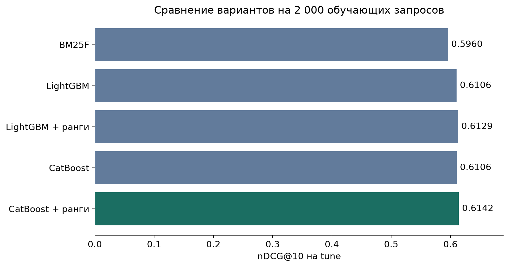
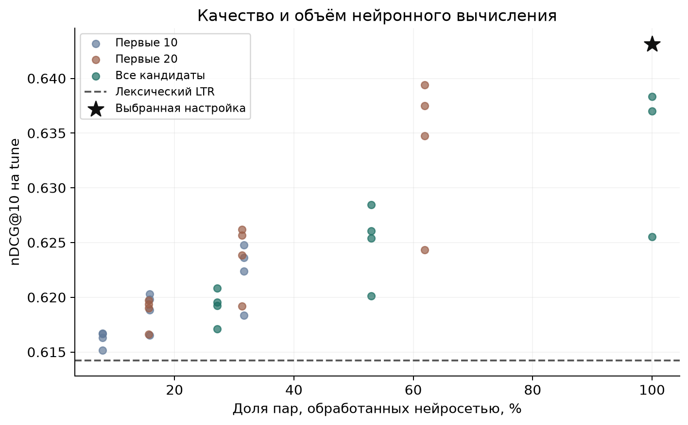
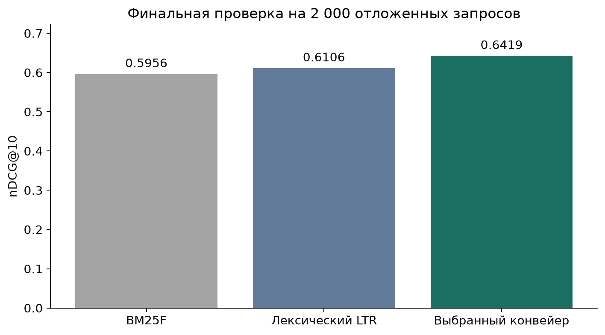
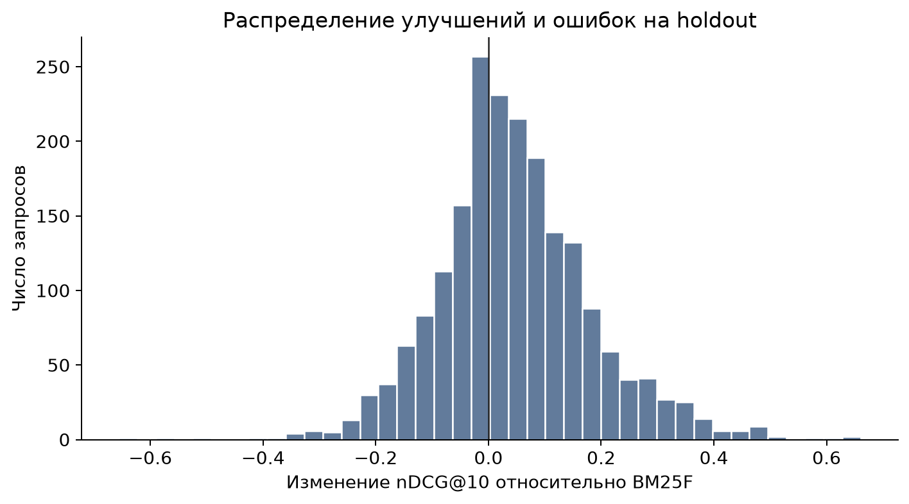

# Ранжирование документов VK MARCO

Игорь Бердов · Kaggle: **whuliss** · Информационный поиск и ранжирование, 2026.

Срок сдачи решения и ссылки на репозиторий — **6 декабря 2026, 23:59 МСК**;
защита — **9 декабря**, доклад на 5–7 минут. Публичный Kaggle-результат
в отчёте остаётся неподтверждённым до фактической отправки.

## Задача и данные

Проект переранжирует уже заданных кандидатов каждого запроса. Извлечение
кандидатов из всего корпуса не оценивается: задача начинается с списка пар
«запрос — документ». Цель — повысить среднюю nDCG@10 относительно BM25F и
измерить вклад обучения ранжированию и открытого нейросетевого переранжировщика.

Использованы только данные финального соревнования. Разметка прошлых ДЗ и
внешние оценки VK MARCO не добавлялись. Предобученная нейросеть применяется
локально с открытыми весами, без дополнительного обучения.

| Набор | Запросы | Пары |
| --- | ---: | ---: |
| Все обучающие данные | 14 543 | 460 030 |
| Fit | 10 543 | 332 960 |
| Tune | 2 000 | 63 289 |
| Holdout | 2 000 | 63 781 |
| Test, метки скрыты | 2 000 | 63 546 |

Полный проход прочитал **1 258 656 документов**. Исходный TSV занимает
16 758 392 268 байт (16,76 ГБ). Для 513 482 уникальных документов-кандидатов
тексты сохранены в SQLite; остальной корпус нужен для статистик терминов.
Словарь терминов всех выданных запросов после нормализации содержит 24 501
элемент. В среднем Title, Body и URL содержат соответственно 9,03, 938,40
и 7,37 нормализованного токена. Источник этих чисел — метаданные полного
`cache/features.npz`, `complete=true`.

## Валидация и метрика

При seed **42** запросы случайно разделены на fit, tune и holdout. Все документы
запроса попадают в одну часть. Идентификаторы не используются как признаки.
Список запросов и SHA-256 разбиения сохранены в
[`reports/official/splits.json`](reports/official/splits.json).

1. Fit используется для обучения кандидатов.
2. Tune используется для выбора BM25F, модели, числа деревьев, ансамбля,
   веса нейросети, глубины переранжирования и порога entropy gate.
3. Конфигурации и хеши входов фиксируются до открытия holdout.
4. Деревья переобучаются на fit+tune с выбранным числом итераций. Holdout
   используется один раз для итогового сравнения и парного bootstrap.
5. Для сабмишна выбранная модель переобучается на всех обучающих запросах.

Для запроса с документами в предсказанном порядке:

$$
DCG@10=\sum_{i=1}^{\min(10,n)}\frac{2^{rel_i}-1}{\log_2(i+1)},
\qquad nDCG@10=\frac{DCG@10}{IDCG@10}.
$$

Каждый запрос имеет одинаковый вес независимо от числа кандидатов. При нулевом
IDCG код возвращает 0. В обучающих qrels нет ObjectId; равные скоры разрешаются
лексикографически по DocumentId. На тесте сохраняется соответствие ObjectId из
`objects.csv`. Tune — набор для подбора; его результат не считается независимой
оценкой качества. Публичный лидерборд не используется для выбора параметров.

## Лексические признаки и BM25F

Потоковая обработка корпуса строит **99 признаков** для каждой пары.
Нормализация: нижний регистр, `ё → е`, удаление комбинируемых ударений, токены
от двух символов и русский Snowball через PyStemmer. Часть признаков сравнивает
исходные нормализованные слова без стемминга.

| Семейство | Что измеряется |
| --- | --- |
| Текстовые модели | BM25 отдельно по полям; 13 вариантов BM25F; BM25 объединённых Title+Body; языковые модели Дирихле с μ=300 и 1500 |
| Покрытие | Доля найденных слов, наличие всех слов, IDF-взвешенное покрытие, частоты и плотность совпадений |
| Порядок слов | Точная фраза, покрытие биграмм, минимальное окно совпадений, первая и последняя позиции |
| Длины и URL | Длины полей, относительные длины, глубина пути, длина домена и query string, HTTPS, цифры |
| Запрос | Число терминов, суммарный и средний IDF, доля неизвестных слов, доля числовых слов |

DF, CF и средние длины вычисляются по **всему выданному корпусу без меток**.
Полная матрица «все документы × весь словарь» не создаётся. Участие текстов
тестовых кандидатов в статистиках корпуса не передаёт модели их релевантность.

В BM25F нормированные частоты полей сначала объединяются, затем насыщаются:

$$
\widetilde{tf}(t,d)=\sum_{f\in\{Title,Body,URL\}}
w_f\frac{tf(t,d_f)}{1-b_f+b_f|d_f|/avglen_f},
$$

$$
BM25F(q,d)=\sum_{t\in q}IDF(t)
\frac{(k_1+1)\widetilde{tf}(t,d)}{k_1+\widetilde{tf}(t,d)}.
$$

На tune выбран `bm25f_k2_t8_u0p25_b0p6`: `k1=2`, веса Title/Body/URL
`8/1/0.25`, `b_body=0.6`, `b_title=b_url=0.3`. Это локальный бейзлайн проекта.
Его значение на holdout нельзя напрямую сопоставлять с 0,592 на публичном
Kaggle: наборы запросов различаются.

## Обучение ранжированию

Сравниваются исходные 99 признаков и их дополнение 99 процентильными рангами
внутри запроса — всего 198 признаков. Для каждого столбца
`percentile=(rank−1)/(n−1)`, равные значения получают средний ранг;
для постоянного столбца и единственного кандидата новый признак равен 0.
Преобразование не обучает состояние и не читает метки.

| Модель | Параметры подбора |
| --- | --- |
| CatBoostRanker | YetiRank, learning_rate=0.04, depth=6, l2_leaf_reg=5, до 1 000 деревьев |
| LightGBM | LambdaRank, learning_rate=0.04, num_leaves=31, min_data_in_leaf=80, lambda_l2=5, feature_fraction=0.9, truncation_level=13, до 1 200 деревьев |

Обе модели обучаются на CPU; seed 42, 4 потока. Число деревьев определяется
early stopping на tune с терпением 100 итераций. Для LightGBM задан
`label_gain=[0,1,3,7]`; для CatBoost — оценка NDCG с экспоненциальным gain.
Отдельно проверены три смеси лучших CatBoost и LightGBM с весом CatBoost
0,25/0,5/0,75. Перед смешиванием скоры стандартизованы внутри запроса.

### Измеренные результаты на tune

Источник — [`experiments.json`](reports/official/experiments.json).
Одинаковые 2 000 tune-запросов используются для всех строк.

| Вариант | nDCG@10 | Δ к BM25F | Деревья |
| --- | ---: | ---: | ---: |
| BM25F | 0.595958 | +0.000000 | — |
| LightGBM, исходные признаки | 0.610568 | +0.014610 | 193 |
| LightGBM, исходные + ранги | 0.612941 | +0.016983 | 393 |
| CatBoost, исходные признаки | 0.610649 | +0.014691 | 361 |
| **CatBoost, исходные + ранги** | **0.614246** | **+0.018288** | **641** |
| Смесь, вес CatBoost 0.25 | 0.613484 | +0.017526 | 641 + 393 |
| Смесь, вес CatBoost 0.50 | 0.613039 | +0.017080 | 641 + 393 |
| Смесь, вес CatBoost 0.75 | 0.613793 | +0.017835 | 641 + 393 |

Ранги улучшили tune-результат LightGBM на 0,002373, CatBoost — на 0,003597.
Лучший из проверенных ансамблей уступил отдельному CatBoost с рангами на
0,000453. Поэтому выбран **CatBoost YetiRank, 641 дерево, 198 признаков**.
Это наблюдения на наборе подбора, без утверждения о статистической значимости.

<!-- FIGURES_TUNE_START -->

Для компактности на графике показаны отдельные модели; все проверенные смеси приведены в таблице выше.
<!-- FIGURES_TUNE_END -->

## Нейросетевое переранжирование и собственный эксперимент

Применяется открытый
[`cross-encoder/mmarco-mMiniLMv2-L12-H384-v1`](https://huggingface.co/cross-encoder/mmarco-mMiniLMv2-L12-H384-v1/tree/1427fd652930e4ba29e8149678df786c240d8825),
revision `1427fd652930e4ba29e8149678df786c240d8825`, Apache-2.0.
Модель выпущена после обучения на переводах MS MARCO; в этом проекте она
используется **zero-shot**, без дообучения. Платные API и внешние qrels VK MARCO
не используются.

Каждая пара кодируется как запрос и заголовок до 40 слов с одним окном Body
до 110 слов; максимальная длина модели — 256 токенов. Окно выбирается по
покрытию стемов запроса на сетке с шагом 55 слов. Выбор окна не использует
оценки релевантности. Длинный документ не обрезается всегда в одной позиции,
но один выбранный фрагмент всё равно может пропустить релевантный материал.

Собственный эксперимент проверяет, можно ли сократить число нейросетевых
оценок без потери качества. Сетка tune содержит:

- глубину префикса: 10, 20 или все кандидаты;
- целевую долю запросов: 25%, 50% или 100%;
- вес нейросети α: 0.25, 0.5, 0.75 или 1.0;
- контроль α=0: только лексическая модель.

Для выбора запросов вычисляется

$$
p=softmax(zscore(s_{LTR})),\qquad
H(q)=-\frac{\sum_i p_i\log p_i}{\log n_q}.
$$

Переранжируются запросы с энтропией выше порога, выбранного по квантилю на tune.
При применении используется зафиксированный **числовой порог**, поэтому доля
обработанных запросов на holdout/test может отличаться от 25% или 50%.
Энтропия — эвристика формы распределения скоров, **не калиброванная вероятность
ошибки или уверенность модели**.

Внутри выбранного префикса смешиваются стандартизованные скоры:
`s=(1−α)·zscore(s_LTR)+α·zscore(s_neural)`. Документы за пределами префикса
сохраняют лексический порядок и не поднимаются над ним. При выборе конфигурации
максимизируется tune nDCG@10; при точном равенстве предпочтителен меньший объём
нейросетевых вычислений.

<!-- NEURAL_RESULTS_START -->
| Глубина | Целевая доля запросов | Лучший α | nDCG@10 | Нейросетевые пары |
| --- | ---: | ---: | ---: | ---: |
| Только LTR | 0% | 0 | 0.614246 | 0 |
| 10 | 25% | 0.75 | 0.616698 | 5 000 (7.9%) |
| 10 | 50% | 0.75 | 0.620311 | 10 000 (15.8%) |
| 10 | 100% | 0.75 | 0.624787 | 20 000 (31.6%) |
| 20 | 25% | 0.75 | 0.619727 | 9 929 (15.7%) |
| 20 | 50% | 0.75 | 0.626216 | 19 813 (31.3%) |
| 20 | 100% | 0.75 | 0.639422 | 39 165 (61.9%) |
| Все | 25% | 0.75 | 0.620852 | 17 195 (27.2%) |
| Все | 50% | 0.75 | 0.628467 | 33 521 (53.0%) |
| Все | 100% | 0.75 | 0.643133 | 63 289 (100.0%) |

Выбрано: **α=0.75, top_k=все, entropy_threshold=0.000000**. Tune nDCG@10 — **0.643133**, разница с выбранным лексическим LTR **+0.028887**.
Для этой конфигурации нужны 63 289 из 63 289 пар (100.0%) на 2 000 из 2 000 запросов.

Каждая точка — отдельный вариант сетки; звезда — выбранная настройка. Это сравнение количества необходимых нейросетевых оценок, а не прямой замер ускорения. Для подбора были заранее вычислены нейросетевые оценки всех tune-пар; накладные расходы и размер батча не позволяют переводить долю пар в точное ускорение.

**Чистая нейросеть** (α=1, все кандидаты всех запросов): nDCG@10 **0.638353**. Выбранная смесь отличается от неё на **+0.004780** на tune.

При ограничении **top-20 для всех запросов** лучший вариант даёт **0.639422** на 61.9% пар. Отставание от выбранной конфигурации — 0.003712. Это возможный компромисс при ограничении вычислений, но финальная конфигурация выбиралась по максимуму качества.

**Отрицательный результат идеи экономии:** на tune победила обработка всех пар. Entropy gate и ограничение глубины не выбраны; экономию нейросетевых оценок финальному решению не приписываем.
<!-- NEURAL_RESULTS_END -->

## Независимая итоговая проверка

<!-- HOLDOUT_RESULTS_START -->
Конфигурация заморожена до оценки **2 000 запросов / 63 781 пар**. `used_for_selection=false`. Для обучения деревьев использованы fit+tune.

| Вариант | nDCG@10 |
| --- | ---: |
| BM25F | 0.595579 |
| Лексический LTR | 0.610591 |
| Выбранный конвейер | 0.641919 |

| Разность | Средняя Δ nDCG@10 | Парный bootstrap, 95% CI |
| --- | ---: | --- |
| Выбранный конвейер − BM25F | +0.046340 | [+0.040256; +0.052206] |
| Выбранный конвейер − лексический LTR | +0.031327 | [+0.026052; +0.036968] |

Bootstrap использует 2 000 повторов с ресемплингом целых запросов. Оба варианта в каждом повторе оцениваются на одних и тех же запросах. Интервал относится к разности метрик; он не учитывает возможный сдвиг данных соревнования.

Относительно BM25F качество выросло на 1 241 запросах, снизилось на 681, не изменилось на 78 (допуск 10⁻¹²). Для выбранной настройки нейросеть обрабатывает 63 781 пар и 2 000 запросов holdout.
<!-- HOLDOUT_RESULTS_END -->

### Примеры выигрышей и ошибок

<!-- QUERY_CASES_START -->
Три запроса выбраны вручную после заморозки модели: выигрыш, ошибка и смешанный результат. Они не использовались для подбора и не являются доказательством причин изменения метрики.

| Запрос | BM25F | LTR | Итог | Δ к LTR |
| --- | ---: | ---: | ---: | ---: |
| франт щёголь 9 букв | 0.257313 | 0.412200 | 0.917884 | +0.505684 |
| нахождение ошибок в английском тексте | 0.509545 | 0.621136 | 0.317296 | -0.303840 |
| развивающие игры составляем слова | 0.632172 | 0.304958 | 0.570605 | +0.265647 |

**франт щёголь 9 букв** (`train:35553`). В top-3 BM25F и LTR преобладают страницы об ответах на 5 букв. Итоговая комбинация выводит три страницы, в заголовках которых явно указаны 9 букв; их Labels — 3, 2, 3. Это наблюдаемое соответствие ограничению запроса в данном списке, а не доказательство общего умения нейросети понимать числовые условия.

В текущей лексической токенизации остаются слова от двух символов, поэтому одноцифровое «9» отсутствует в термах запроса; cross-encoder получает исходный запрос. Это правдоподобная гипотеза для различия на этом примере, но причинность без отдельной абляции не установлена. Сохранение одноцифровых чисел — направление дальнейшей работы; зафиксированный токенизатор не менялся.

**нахождение ошибок в английском тексте** (`train:39526`). Итоговая комбинация ставит первой страницу «Нахождение — ошибка» из энциклопедии нефти и газа с Label=1. У LTR первой была страница о программе поиска ошибок с Label=2, а третьей — о проверке английского текста с Label=2. На этом запросе итоговое nDCG@10 ниже обеих лексических оценок; один пример не устанавливает, связана ли ошибка с окном текста, моделью или способом смешивания.

**развивающие игры составляем слова** (`train:42243`). Итоговая комбинация возвращает страницу «Читаем и составляем слова» с Label=3 на второе место, но первой оставляет онлайн-игру с Label=1. BM25F ставит документ с Label=3 первым. Итог лучше LTR по nDCG@10, однако не достигает результата BM25F; улучшение относительно обученной модели не означает улучшения относительно каждого бейзлайна.

Метрика учитывает top-10, а наблюдения выше описывают top-3. По этим целенаправленно выбранным примерам нельзя оценить частоту ошибок. Полные списки с оценками, заголовками и фрагментами: [`query-cases.md`](reports/official/query-cases.md); данные и хеши: [`query-cases.json`](reports/official/query-cases.json).
<!-- QUERY_CASES_END -->

## Время, память и воспроизводимость

Полный проход корпуса на macOS arm64, Python 3.12.3 занял **1 323,66 с
(22,06 мин)**. Пиковый RSS дочернего процесса — **1,21 ГиБ**. Это реальный
замер полного извлечения, а не экстраполяция пилота. RSS не включает отдельную
память GPU. Источник — [`reports/features/runtime.json`](reports/features/runtime.json).
Сравнение четырёх моделей и ансамблей на уже готовых признаках заняло
268,27 с (4,47 мин), по `experiments.json`.

<!-- RUNTIME_RESULTS_START -->
Нейросетевой проход tune №1: 63 289 пар, 420.66 с, 150.45 пары/с. Устройство `mps`, batch_size=32.

| Измеренный этап | Время, с | Пик RSS, ГиБ |
| --- | ---: | ---: |
| [Полные признаки, macOS](reports/features/runtime.json) | 1323.66 | 1.21 |
| [reports/linux-final-unit-tests-runtime.json](reports/linux-final-unit-tests-runtime.json) | 1.01 | 0.15 |
| [Полные признаки, Linux](reports/linux-full-features-runtime.json) | 2034.51 | 1.11 |
| [Нейросетевые 96 пар, Linux CPU](reports/linux-neural-smoke-runtime.json) | 20.50 | 1.06 |
| [Переобучение фиксированного CatBoost, Linux](reports/linux-refit-runtime.json) | 289.99 | 2.68 |
| [Аудит holdout, MPS](reports/official/audit-runtime.json) | 601.86 | 2.13 |
| [Финальный CPU-запуск, готовые признаки](reports/official/final-runtime.json) | 1767.83 | 1.54 |
| [Нейросетевой tune, MPS](reports/official/neural-tune-runtime.json) | 429.52 | 1.09 |
| [Подбор лексических моделей](reports/official/tuning-runtime.json) | 269.06 | 2.03 |

Разные строки могут описывать вложенные этапы, поэтому их время не следует механически складывать. Замеры RSS не включают отдельную память GPU; они относятся к указанной платформе, а не гарантируют такую же скорость на другом CPU.
<!-- RUNTIME_RESULTS_END -->

Замеры не являются изолированным сравнением устройств: при финальном CPU-запуске
параллельно запущена проверка полного извлечения признаков в Linux. Конкуренция
за ресурсы влияет на скорость; отношение измеренных времён CPU/MPS не следует
трактовать как характеристику только самих устройств.

Зафиксированы seed, зависимости, разбиение, конфигурации, версия нормализации,
revision и SHA-256 весов. Кэши проверяют соответствие данным и конфигурациям;
нейросетевые оценки хранят маску готовых строк, поэтому отсутствующее
предсказание не подменяется нулём. Подробные команды — в [README](README.md).

<!-- LINUX_RESULTS_START -->
В Linux aarch64 / Python 3.12.16 / CPU прошли **32 из 32** исходных синтетических/unit-тестов, проверки импортов и `pip check`. Затем независимо обработан весь корпус: получена матрица **523 576 × 99** `float32`. Имена признаков, идентификаторы, метки и статистики корпуса совпали.

**Побитовое сравнение матрицы не прошло:** отличаются 28 458 элементов только в 3 столбцах (`lm_title_mu1500`, `lm_body_mu1500`, `lm_url_mu1500`). Максимальная абсолютная разница — **9.54e-07**; остальные 96 столбцов совпали. Диагностический пример локализовал различие в платформенном `float32 np.log1p` для длинового штрафа LM с μ=1500. Исходный отчёт с `success=false` сохранён; эту проверку не выдаём за успешное побитовое равенство.

**Проверка происхождения вместо привязки к последним битам.** `portability.py` сверяет исходные файлы, сохранённый SHA-256 полного корпуса, код извлечения и зафиксированных компонентов, версии NumPy/PyStemmer, схему, идентификаторы, метки, статистики и разбиение. Для текущего запуска в копии конфигурации пересчитываются только хеши fit/tune. Метод, выбранные гиперпараметры и исходные `best_config.json`/`fusion_config.json` не меняются; повторного подбора нет. Полный SHA-256 корпуса вычисляется при извлечении; при повторном использовании кэша сверяются размер, время изменения и хеши краёв файла. Это проверка происхождения штатного кэша или нового извлечения, **не поэлементная проверка допуска погрешности X** и не проверка произвольно отредактированной матрицы.

**Независимое обучение в Linux:** CatBoost с теми же 641 деревьями и seed 42 переобучен на всех 460 030 строках. Ранжирование всех 63 546 тестовых пар совпало с macOS; запросов с другим порядком — 0. Максимальная разница лексических скоров — 1.55e-15.

**Комбинация с переобученной Linux-моделью и теми же ранее вычисленными нейросетевыми оценками Mac CPU** дала побитово исходный CSV: `bee099f6d3d48d0554bedb03bd3c8041191fc31072ab11c1263641f5aa2fdb5f`. Эта проверка подтверждает переносимость извлечения, обучения и смешивания, но сама по себе не проверяет повторный расчёт всех нейросетевых оценок в Linux.

**Настоящий нейросетевой расчёт на Linux CPU:** заново обработаны 96 пар из 3 полных тестовых групп (test:50, test:67, test:218). Порядок нейросети и результат смешивания на этих группах совпали с macOS; максимальная разница логитов — 1.24e-05. Это проверка подмножества, не всех тестовых запросов.

После исправления совместимости прошли **40 Linux-тестов**, проверка происхождения полного кэша и строгая проверка повторного использования модели в `fit_final` ([итоговая проверка](reports/linux-portability-check.json)).

На macOS финальные 40 тестов и повторный CLI-запуск с готовым кэшем (5.04 с) подтвердили, что исправление совместимости сохранило исходный CSV ([проверка финального кода](reports/official/final-code-check.json), [отчёт повторного запуска](reports/official/portable-cli-replay.json)).

**Граница проверки:** полный пересчёт всех нейросетевых оценок теста внутри Linux пока не выполнялся. Полный холодный запуск всего конвейера в Linux не заявляется как измеренный. Проверена архитектура aarch64; Linux x86_64 не проверялся.

Источники: [`linux-smoke.json`](reports/linux-smoke.json), [`linux-full-feature-comparison.json`](reports/linux-full-feature-comparison.json), [`linux-numeric-portability-probe.json`](reports/linux-numeric-portability-probe.json), [`linux-refit-comparison.json`](reports/linux-refit-comparison.json), [`linux-fusion-comparison.json`](reports/linux-fusion-comparison.json), [`linux-neural-smoke.json`](reports/linux-neural-smoke.json), [`linux-runtime-selection-portability.json`](reports/linux-runtime-selection-portability.json).
<!-- LINUX_RESULTS_END -->

## Ограничения и выводы

Результат относится к переранжированию выданных кандидатов, а не к качеству
полноценного поиска с самостоятельным retrieval. Подбор по одному tune-split
может переобучить выбор конфигурации; отдельный holdout снижает этот риск,
но не заменяет несколько независимых разбиений. Статистики полного выданного
корпуса допустимы для этой постановки и потребуют пересчёта при смене корпуса.

На tune полезными оказались обучаемая модель и ранги внутри запроса.
Проверенные смеси деревьев не превзошли одиночный CatBoost с рангами.
Нейросетевые оценки требуют дополнительных вычислений; пользу и стоимость
условного переранжирования следует оценивать по фактическим результатам ниже.

<!-- CONCLUSIONS_START -->
Итоговый holdout nDCG@10 — **0.641919**, разница с BM25F **+0.046340**, с лексическим LTR **+0.031327**. Интервал улучшения относительно LTR находится выше нуля.

Публичный Kaggle-скор ещё не получен; победа над официальным бейзлайном 0.592 пока не подтверждена.
<!-- CONCLUSIONS_END -->

Условия: [официальный README проекта](https://github.com/RuslanAllayarov/ir-course-hse-2026/tree/main/project).
Все численные результаты подбора сохраняются в `reports/official/`, графики —
в `reports/figures/`. `scripts/build_report.py` строит визуализации из JSON
и сохраняет SHA-256 исходных отчётов; `scripts/build_slides.mjs` собирает
редактируемую презентацию для защиты.
